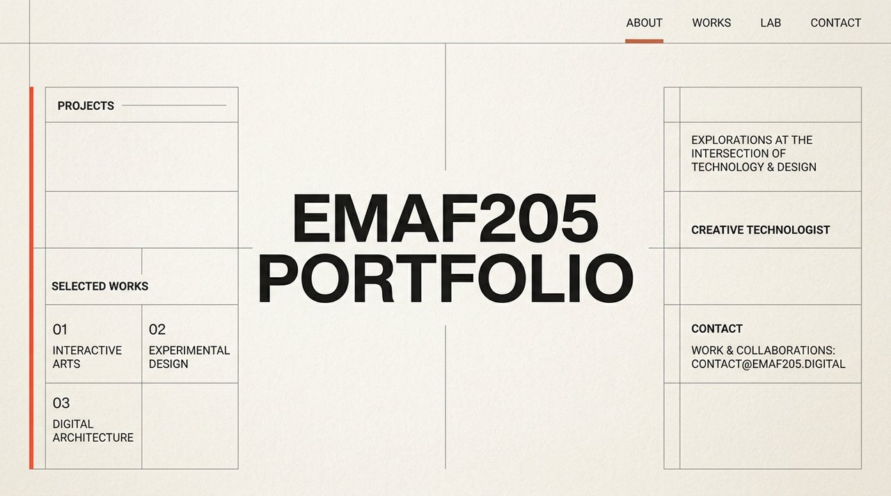

# EmaF205 Landing // Architectural Portfolio & Showcase

<p align="center">
  
</p>

> **Architectural, editorial portfolio landing page built with Swiss typographic discipline, modular sections, and lightweight vanilla code.**

---

## Overview

**EmaF205 Landing** is the foundational portfolio codebase for Emanuele BDC. Designed with an editorial, gallery-grade aesthetic, it brings together architectural grid layouts, generous typography, subtle interactions, and pure lightweight vanilla code (PHP + CSS + ES6).

---

## Core Highlights

- **Swiss Modernist Design**: Bold typographic hierarchy, warm linen canvas tones, and architectural wireframe accents.
- **Zero Heavy Frameworks**: Pure vanilla CSS and minimal JavaScript—no React, Vue, or large bundle overhead.
- **Lightweight PHP Routing**: Clean, single-file server handling for contact form submissions and dynamic asset cache-busting.
- **Mobile Responsive**: Adapts fluidly from small smartphone viewports to ultra-wide desktop monitors.
- **Performance Optimized**: Sub-second First Contentful Paint (FCP) and near-perfect Core Web Vitals scores.

---

## Structure

```
emaf205-landing/
├── index.php                 # Main entrypoint with dynamic cache-busting
├── custom.css                # Modular, framework-free design system
├── demo/                     # Visual references and mockups
└── assets/
    └── social-preview.jpg    # Bespoke project showcase banner
```

---

## Getting Started

1. Clone the repository:
   ```bash
   git clone https://github.com/emaf205/emaf205-landing.git
   ```
2. Serve locally using the built-in PHP server:
   ```bash
   php -S localhost:8000
   ```
3. Open `http://localhost:8000` in your browser.

---

## License & Attribution

Designed and coded by **Emanuele BDC (EmaF205)**.  
Released under the [MIT License](LICENSE).
