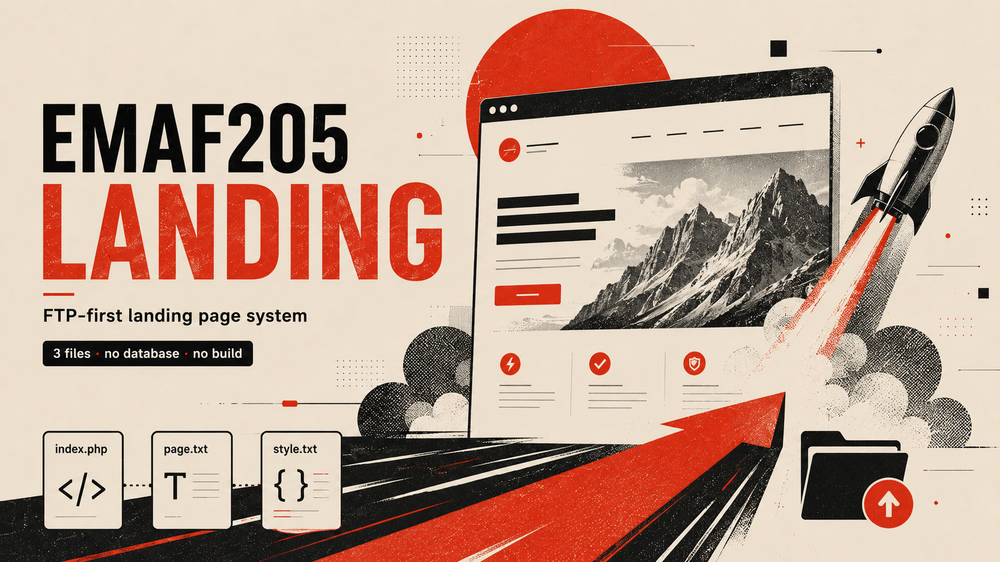
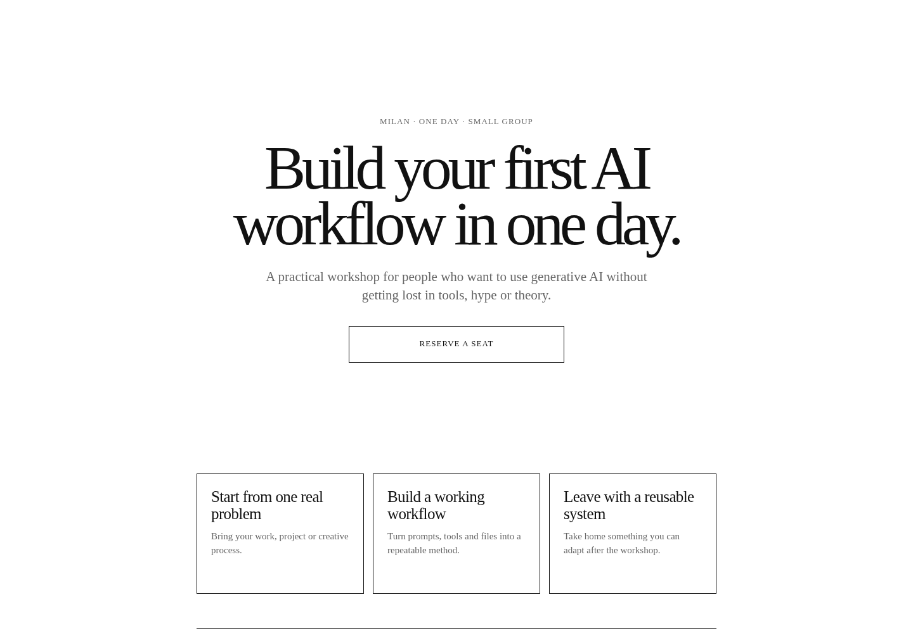
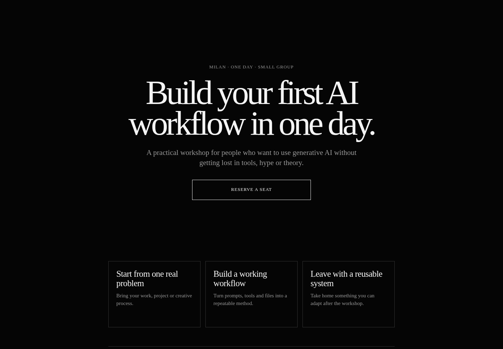
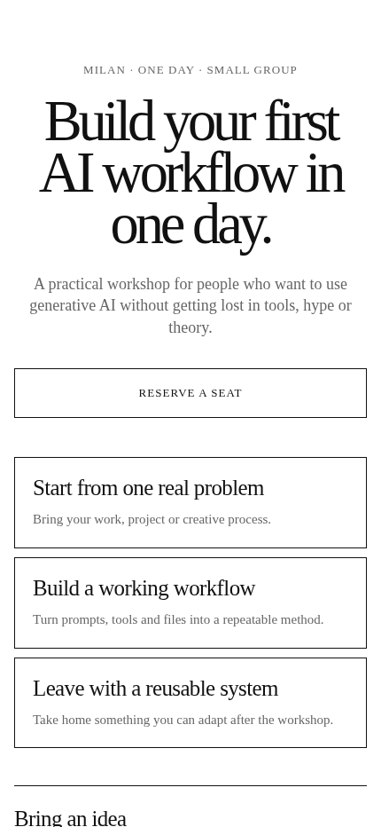

<p align="center">
  
</p>

# EMAF205 Landing — Minimal PHP Landing Page Generator

**A lightweight, self-hosted PHP landing page system for creators, consultants, workshops, digital products, services and small launches.**

Build a clean responsive landing page by editing simple text files, then upload it with FTP. **No database, no CMS, no admin panel, no JavaScript framework and no build step.**

> **Edit. Upload. Done.**

## Why EMAF205 Landing

EMAF205 Landing is designed for people who want a **simple PHP landing page** without installing WordPress, configuring a database or maintaining a complex frontend stack.

The runtime stays intentionally small:

```text
index.php      → landing page engine
page.txt       → content and sections
style.txt      → colors and typography
custom.css     → optional advanced overrides
```

Empty optional sections disappear automatically, so you can create different landing pages without touching the PHP engine.

## Screenshots

### Light theme

<p align="center">
  
</p>

### Dark theme

<p align="center">
  
</p>

### Mobile

<p align="center">
  
</p>

## Features

- **FTP-first deployment** — upload the files and the page is online
- **No database** — fully file-based
- **No build process** — no Node.js, bundler or package manager required
- **No CMS or admin panel** — content lives in `page.txt`
- **Responsive layout** — desktop and mobile friendly
- **Lightweight PHP** — small runtime with no external framework
- **Custom styling** — use `style.txt` for the basics and `custom.css` for advanced changes
- **Flexible sections** — Hero, Points, How it works, Details, Final CTA and Footer
- **Optional sections** — leave content empty and unused sections disappear
- **Security-minded defaults** — output is escaped and unsafe URL schemes are blocked

## Quick start

1. Download [`dist/EMAF205-Landing.zip`](dist/EMAF205-Landing.zip).
2. Extract the files.
3. Edit `page.txt` with your content.
4. Edit `style.txt` with your colors and font.
5. Upload the files to a PHP-enabled folder using FTP.
6. Open the folder URL in your browser.

Example deployment:

```text
/public_html/my-landing/
├── index.php
├── page.txt
├── style.txt
└── custom.css
```

## How it works

`index.php` reads `page.txt` and `style.txt`, validates the supported values and renders the final responsive HTML page.

You normally edit only:

```text
page.txt
style.txt
```

Advanced users can also edit:

```text
custom.css
```

## Landing page structure

```text
Hero
↓
Key points
↓
How it works
↓
Details
↓
Final CTA
↓
Footer
```

This fixed structure keeps the page focused while still supporting many use cases.

## Perfect for

- Product landing pages
- Digital product launches
- Workshops and courses
- Consulting and service pages
- Event pages
- Personal brands and portfolios
- Download pages
- Coming-soon pages
- Small campaigns
- Independent experiments

## Example content

`page.txt` uses a simple readable format:

```text
SITE_TITLE: AI Workshop Milan
SITE_DESCRIPTION: A practical one-day workshop for creators and independent professionals.

EYEBROW: Milan · One day · Small group
HERO_TITLE: Build your first AI workflow in one day.
HERO_TEXT: A practical workshop for people who want to use generative AI without getting lost in tools, hype or theory.

CTA_TEXT: Reserve a seat
CTA_URL: mailto:you@example.com
CTA_TARGET: _self
```

## Style configuration

Change the basic visual system in `style.txt`:

```text
BACKGROUND_COLOR: #ffffff
TEXT_COLOR: #111111
MUTED_TEXT_COLOR: #666666
FONT: serif

BUTTON_BACKGROUND: transparent
BUTTON_TEXT_COLOR: #111111
BUTTON_BORDER_COLOR: #111111
LINE_COLOR: #111111
```

For advanced styling, use `custom.css`.

## Included examples

Ready-to-edit examples are available in [`examples/`](examples/):

- `workshop-page.txt`
- `service-page.txt`
- `download-page.txt`
- `light-style.txt`
- `dark-style.txt`

Static demo renders are available in [`demo/`](demo/):

- `light.html`
- `dark.html`

## Documentation

- [Installation guide](docs/INSTALL.md)
- [`page.txt` guide](docs/PAGE-TXT-GUIDE.md)
- [`style.txt` guide](docs/STYLE-TXT-GUIDE.md)
- [`custom.css` guide](docs/CUSTOM-CSS.md)

## Requirements

- PHP 8+ recommended
- Basic web hosting with PHP
- FTP or another way to upload files

No database server is required.

## Security

EMAF205 Landing keeps the attack surface small by design.

- Page content is escaped before rendering
- Unsafe URL schemes such as `javascript:`, `data:` and `vbscript:` are blocked
- Style colors accept only supported HEX values
- No database credentials
- No login or admin panel
- No third-party runtime dependencies

## Download

The ready-to-upload package is available here:

**[`dist/EMAF205-Landing.zip`](dist/EMAF205-Landing.zip)**

## Project philosophy

Most landing page builders are powerful because they do many things.

**EMAF205 Landing is useful because it deliberately does less.**

It is made for situations where you need a clean, self-hosted landing page quickly and want to keep full control of the files.

## License

MIT License. See [`LICENSE`](LICENSE).

---

**Made with ❤️ in Milan by EmaF205**
